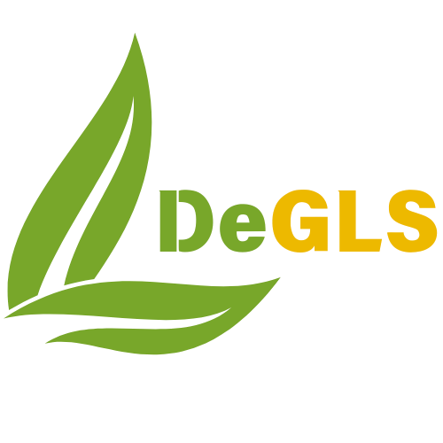
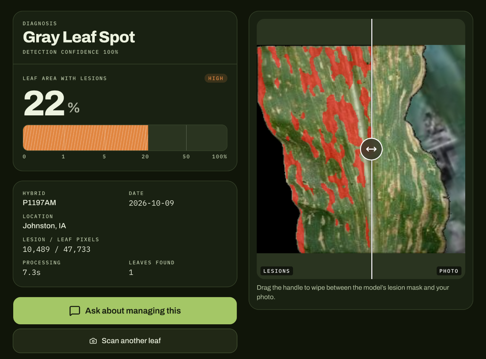
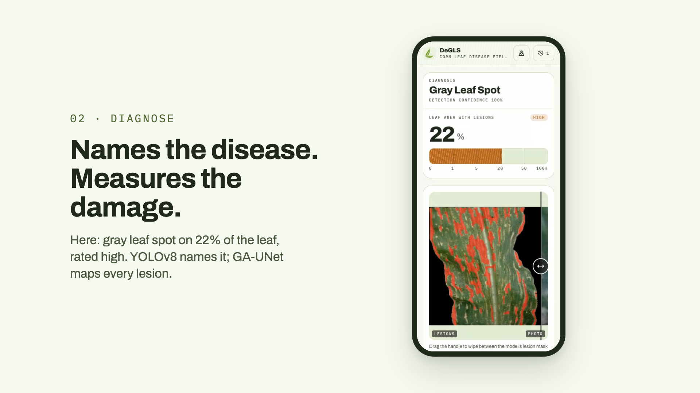
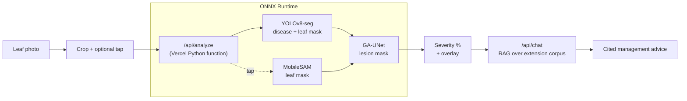

<p align="center">
  
</p>

<h1 align="center">DeGLS</h1>

<p align="center">
  <em>Photograph a corn leaf. Get the disease, how much of the leaf it has taken, and what to do about it.</em>
</p>

<p align="center">
  <a href="https://github.com/unio207/DeGLS/actions/workflows/ci.yml"></a>

https://github.com/user-attachments/assets/903d3208-76a1-4978-94f7-3f2c19df5871

  <a href="LICENSE"></a>
  
  
  
</p>

<p align="center">
  <b><a href="https://degls.vercel.app">Live demo</a></b> ·
  <b><a href="https://youtu.be/dPj_7HmI-1g">Video</a></b> ·
  <b><a href="https://isef.net/project/soft047-deep-learning-detection-system-for-gray-leaf-spot">ISEF project page</a></b>
</p>

---

**DeGLS** (Detection of Gray Leaf Spot) is a field tool for corn growers and agronomists. From a single phone photo of a leaf it identifies **gray leaf spot**, **northern corn leaf blight** or **common rust**, segments every lesion, and reports the percentage of the blade that is diseased, the number that actually drives a fungicide decision. A built-in assistant then answers "what do I do about this?" from the diagnosis, with retrieval over 23 university extension publications once the index is built. In the 2025 paper, the deployed lesion segmenter (GA-UNet) scored IoU 0.773; see [Results](#results).

The project won a 3rd Place Grand Award at the Regeneron International Science and Engineering Fair (ISEF 2025, Systems Software, SOFT047).

<p align="center">
  
</p>

## Demo

<p align="center">
  <a href="docs/media/demo.mp4">
    
  </a>
  <br>
  <sub>28-second product demo, recorded from the live app on a sample leaf (<code>tests/fixtures/IMG_0551.jpeg</code>). Click to play.</sub>
</p>

<p align="center">
  <a href="https://youtu.be/dPj_7HmI-1g">
    
  </a>
  <br>
  <sub>Two-minute project video from ISEF 2025, click to watch on YouTube.</sub>
</p>

## Features

- **Disease identification**: a YOLOv8 segmentation model detects the leaf and classifies it as gray leaf spot, northern leaf blight or common rust.
- **Severity as a number**: a GA-UNet lesion segmenter measures lesion pixels against leaf pixels, placed on the standard 0–1–5–20–50–100% severity scale.
- **Tap-to-select leaf**: the user taps the leaf to measure, and the tap prompts **MobileSAM** for that leaf's mask, so the reading covers the leaf you meant, not the one behind it. SAM is off by default (`DEGLS_SAM=0`) and runs only on a request that carries a tap (`?sam=1`); its memory use against Vercel's 1024 MB cap is not yet proven.
- **Crop before scanning**: exclude soil, hands and background before anything is measured.
- **Guards against confident nonsense**: a leaf-plausibility check rejects photos that are not mostly leaf-like vegetation (noise, flat images, non-plant scenes; other green plants still pass), and a chlorosis guard withholds severe readings on uniformly yellowed tissue that the segmenter tends to over-count.
- **Management assistant**: retrieval-augmented chat over 23 university extension and Crop Protection Network publications in [`corpus/`](corpus/), so answers cite a real source. (The committed index is empty until it is built with `scripts/ingest_corpus.py`; without it the assistant answers from the diagnosis alone and says so.)
- **Scan history and map**: past scans, with hybrid, location and date, are kept on-device (IndexedDB) and plotted on an OpenStreetMap map.
- **Installable PWA**: laid out for phones and iPads in the field.

## How it works



1. The browser crops and downscales the photo, then posts it to a **stateless Python function**. Nothing is written to disk; the overlay comes back as a data URI.
2. **YOLOv8-seg** finds the leaf and names the disease. When the user taps, **MobileSAM**, prompted at the tap, provides the leaf mask instead.
3. **GA-UNet** segments lesions on the isolated leaf at 512×512. Severity is lesion pixels ÷ leaf pixels.
4. The diagnosis is passed to the **chat route**, which embeds the question, retrieves the closest passages from `data/embeddings.json` by cosine similarity, and streams an answer that cites them. The committed index is empty, so until `scripts/ingest_corpus.py` is run the answer comes from the diagnosis alone.

YOLOv8 and GA-UNet were trained in PyTorch and exported to ONNX with MobileSAM ([`scripts/export_onnx.py`](scripts/export_onnx.py)), so the deployed function runs on `onnxruntime` + `opencv-headless` with no torch: 288 MB of Python dependencies (measured, see `api/requirements.txt`) plus 96 MB of ONNX models, about 384 MB against Vercel's 500 MB function limit. [`scripts/verify_parity.py`](scripts/verify_parity.py) checks the ONNX path against the original PyTorch models on every fixture.

## Results

From the 2025 research paper behind this project, which is not in this repo. The paper does not say whether these scores are on the validation or the test split. They were measured on the 2025 PyTorch models (weights in `legacy/`), and the ONNX exports in `models/` are checked against those weights by `scripts/verify_parity.py` (which needs torch and ultralytics, in neither requirements file). The labeled training set no longer exists, so these numbers cannot be re-measured, and the input guards and thresholds added since were tuned by eye on sample photos.

**Leaf segmentation and disease classification.** YOLOv8 was trained on 3,737 images from PlantVillage and the CD&S field dataset (GLS, NLB, common rust and healthy), split 80/10/10 (so each evaluation split is about 374 images), for 50 epochs. The shipped `models/yolo.onnx` has three classes and no healthy class. Leaf segmentation scored precision 0.958, recall 0.965 and mAP 0.974 (the paper does not state the IoU threshold for that mAP). Disease classification averaged 94.7% recall across gray leaf spot, northern leaf blight and common rust; most errors were NLB read as GLS or the reverse.

**Lesion segmentation.** Four U-Net variants were trained for 50 epochs on 799 images (752 GLS, 47 healthy), split 80/10/10, so each evaluation split is about 80 images:

| Model | IoU | F1 | Specificity |
|---|---|---|---|
| Modified RAAWC U-Net | 0.805 | 0.890 | 0.978 |
| **GA-UNet (deployed)** | 0.773 | 0.885 | 0.984 |
| Baseline U-Net | 0.729 | 0.827 | 0.983 |
| RAAWC U-Net | 0.633 | 0.770 | 0.970 |

Modified RAAWC beats GA-UNet on IoU (p < 0.05). GA-UNet is deployed anyway because it has fewer parameters and a simpler architecture; the paper chose it for lightweight deployment.

**Against human experts.** Two agricultural professionals scored 255 GLS leaves. They agreed with each other at r = 0.84, and the Modified RAAWC model agreed with their average at r = 0.89. On rotated and shaded copies of the same leaves, the model's scores showed "deviations of less than 3%" while the experts' changed "over 15%" (the paper's wording; it does not say points or relative). This comparison was run with Modified RAAWC (the paper's Fig. 9), not with the deployed GA-UNet.

Known limits: the detector has no healthy or reject class, so a healthy leaf still gets a disease name and the severity reading is the signal to trust; severity is not scale-invariant (one photo reads 12.51% at full resolution and 2.64% at 0.145 scale), and GA-UNet counts uniformly yellowed tissue as lesion, which is why the chlorosis guard exists. The guard's 45% ceiling comes from a correlation over 19 images, not from a trained model.

## Tech stack

| Layer | Technology |
|---|---|
| Frontend | Next.js 16 (App Router), React 19, TypeScript, Tailwind CSS 4, shadcn/ui, Leaflet |
| Inference | Python 3.12 serverless function, ONNX Runtime, OpenCV, NumPy |
| Models | YOLOv8s-seg (disease + leaf), GA-UNet (lesions), MobileSAM (tap-prompted leaf mask) |
| Assistant | Vercel AI SDK, OpenAI chat + `text-embedding-3-small`, in-memory vector search |
| Hosting | Vercel |

## Project structure

```
.
├── app/                 Next.js routes: the scan page and /api/chat
├── components/
│   ├── scan/            capture, crop, results, history and map
│   ├── chat/            management assistant UI
│   └── ui/              shadcn/ui primitives
├── lib/                 RAG retrieval, on-device history, shared types
├── api/                 /api/analyze, the Python inference function
├── models/              ONNX weights (YOLO, GA-UNet, MobileSAM)
├── corpus/              extension publications behind the assistant
├── data/                embedding index (committed empty; built by scripts/ingest_corpus.py)
├── scripts/             ONNX export, parity check, corpus ingest, smoke tests
├── tests/fixtures/      sample leaf photos
├── docs/images/         README screenshots
├── public/              logo, PWA manifest and icons
└── legacy/              the original 2025 Flask version
```

## Getting started

**Requirements:** Node.js 20+, Python 3.12, and the [Vercel CLI](https://vercel.com/docs/cli) to run the Python function locally.

```bash
git clone https://github.com/unio207/DeGLS.git
cd DeGLS
npm install
```

Create `.env.local` with an OpenAI key for the assistant (the scanner works without it):

```bash
OPENAI_API_KEY=sk-...
```

Run the full stack (Next.js and the Python function) with the command below. The first run asks you to `vercel login` and create or link a Vercel project of your own.

```bash
npx vercel dev
```

To see the models work without the web app, install the function's dependencies and run it on a fixture:

```bash
python3.12 -m venv .venv && source .venv/bin/activate
pip install -r api/requirements.txt
python api/analyze.py tests/fixtures/IMG_0551.jpeg
```

Or run only the frontend with `npm run dev` and append `?mock=gls` (also `nlb`, `rust`, `severe`, `no_leaf`, …) to the URL to render a result state without the Python function. Mock mode is disabled in production builds.

### Useful scripts

```bash
npm run lint                                  # ESLint
python scripts/smoke_api.py                   # end-to-end test of /api/analyze
pip install -r scripts/requirements.txt       # once; needs OPENAI_API_KEY in .env.local
python scripts/ingest_corpus.py --dry-run     # see what would be embedded
python scripts/ingest_corpus.py               # rebuild data/embeddings.json from corpus/
python scripts/threshold_sweep.py             # contact sheet of lesion masks by threshold
```

The inference function is tuned through `DEGLS_*` environment variables (lesion threshold, SAM on/off, plausibility and severity guards); each is documented where it is read in [`api/analyze.py`](api/analyze.py).

## Background

The first version of DeGLS (in [`legacy/`](legacy/)) was a Flask app running PyTorch and Ultralytics on a server. This repository is a rebuild for use on phones in the field: serverless ONNX inference, a mobile-first interface, input guards, and a self-hosted RAG assistant in place of a third-party chatbot.

## License

[MIT](LICENSE) © Henry Zou

The MIT license covers the code. Documents in `corpus/` remain the work of their original publishers (public university extension material, redistributed with attribution); see [`corpus/README.md`](corpus/README.md).
